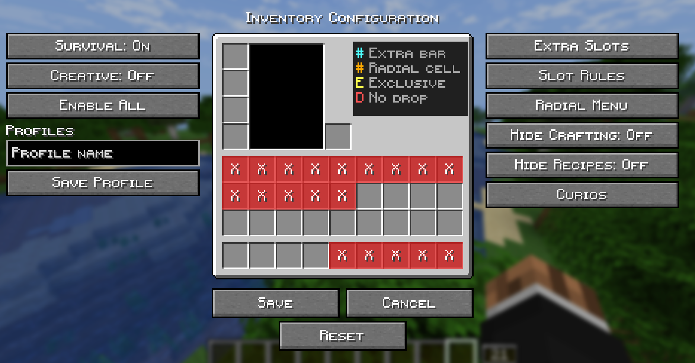
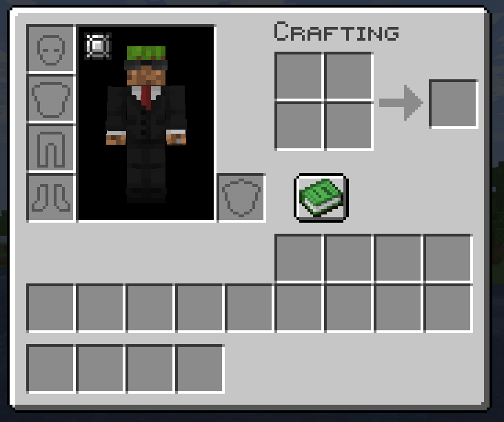
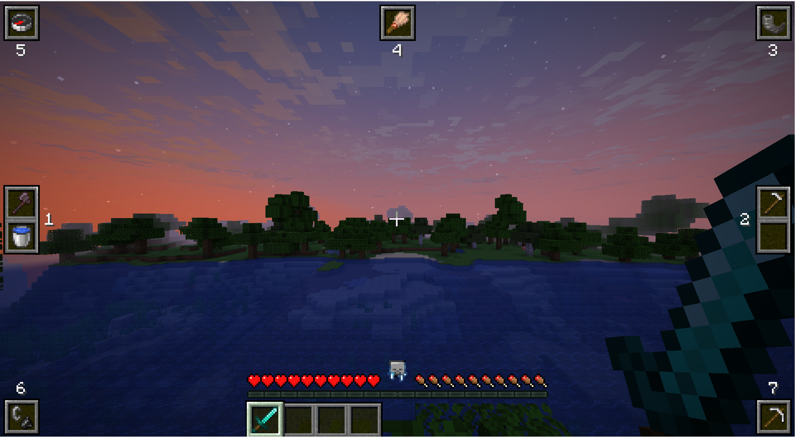
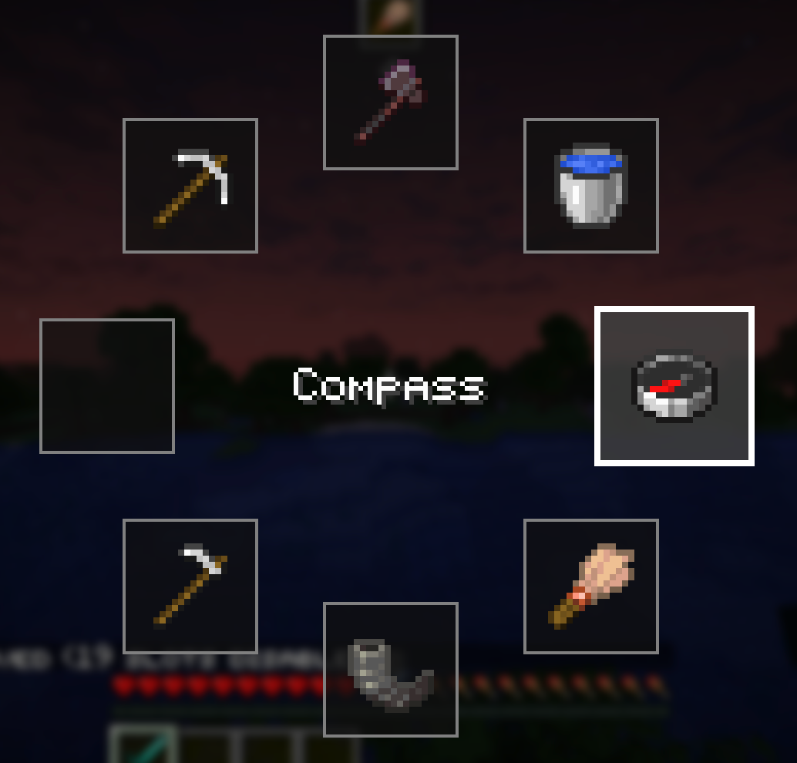
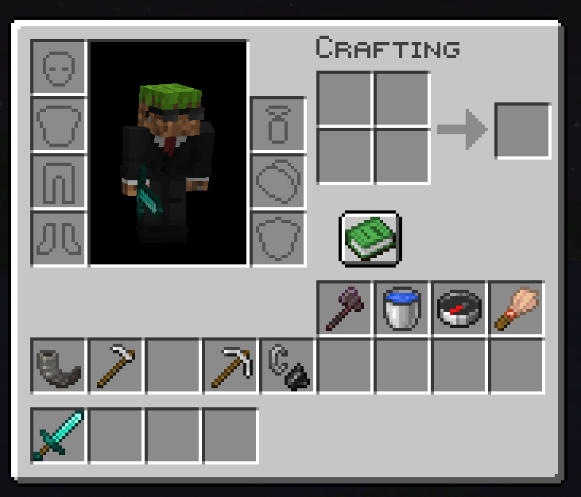

**Take full control of the player inventory, in-game, server-wide, no config files.**

[**Source**](https://github.com/LosTomobri/inventory-config) &nbsp;•&nbsp; [**Issues**](https://github.com/LosTomobri/inventory-config/issues)

---

## What is Inventory Config?

Type `/inventoryconfig` and a screen with your **full inventory** opens. Click (or drag) over a slot to disable it, and hit **Save**: the change applies to **every player on the server** and is stored per world.

That is only the start. On top of slot control, the mod adds **extra hotbars**, a **radial menu**, **per-slot rules** and **named profiles** that save your whole layout, all configured from the same screen.

Perfect for **modpack makers**, **server owners**, **challenge runs** and **adventure maps** that need a custom inventory.

---

## Features

### Slot Control

- Disable **any of the 41 player slots**: hotbar, main inventory, armor and offhand.
- Click or **drag** to toggle many slots at once. **Enable All** and **Reset** are one button away.
- Separate switches for **Survival / Adventure** and **Creative** (Spectator is never affected).
- Optional **Hide Crafting** and **Hide Recipes** to clean up the inventory screen.

### Compact UI

Disabled rows do not leave ugly holes: the inventory **shrinks to fit**. It works with the vanilla screens (inventory, chests, furnaces, crafting table, hopper, dispenser and more) and with Curios. Screens from other mods are analyzed automatically, and when one cannot be shrunk its disabled slots are simply covered.

### Extra Hotbars

- Create up to **8 extra hotbars**, one per position: *Top Left, Top Center, Top Right, Left, Right, Above Hotbar, Bottom Left, Bottom Right*.
- Each bar takes up to **5 slots** from your main inventory (slots 9 to 35).
- Switch with the **number keys** and the **mouse wheel**. Every bar has its own rebindable key (1 to 8 by default). **Tap** the key for the normal hotbar slot, **hold** it to open the extra bar.
- The item is **really swapped into your hand**, so attacks, tools and other mods work with it. If you die, disconnect or the game crashes, the swap is undone automatically.
- **Hide in Inventory** removes the assigned slots from the inventory view.

### Radial Menu

- **8 cells**, each linked to one inventory slot.
- **Hold** mode: open with the key, release on a cell to pick it. **Toggle** mode: open with the key, pick with a click.
- Adjustable center dead zone. Default key is `<` (the extra key left of Z on ISO keyboards, such as Spanish and Latin American ones). On US keyboards, rebind it in *Controls*.

### Slot Rules

Set rules on **every inventory slot**:

| Rule | What it does |
|:---|:---|
| **Fixed items** | The slot only accepts the items you choose (up to 64 different items per slot). |
| **Exclusive** | Those items cannot go into any slot that does not list them. |
| **No drop** | What is in the slot cannot be thrown away or moved to an outside container. |

A built-in item picker supports search by name or id, and `@mod` filters by mod.

### Profiles

Save the **whole layout** (disabled slots, extra hotbars, rules and radial menu) under a name, load it any time and switch setups in seconds. Up to 64 profiles per world.

### Curios Integration (optional)

If [Curios API](https://modrinth.com/mod/curios) is installed, you can **show Curios slots directly in the inventory** and hide the Curios button.

---

## Commands

All commands need **operator permissions** (level 2). In singleplayer, enable cheats.

| Command | Description |
|:---|:---|
| `/inventoryconfig` | Opens the configuration screen. |
| `/inventoryconfig status` | Shows the current state: modes, disabled slots and profiles. |
| `/inventoryconfig survival [true\|false]` | Enable the mod for Survival and Adventure (default: `true`). |
| `/inventoryconfig creative [true\|false]` | Enable the mod for Creative (default: `false`). |

---

## Client Options

Per-player settings live in `inventoryconfig-client.toml`:

| Option | Default | Description |
|:---|:---:|:---|
| `holdThresholdMs` | `250` | How long (ms) a number key must be held to open its extra hotbar. |
| `radialMode` | `HOLD` | `HOLD` or `TOGGLE`. |
| `radialDeadZone` | `24` | Radius in pixels of the radial menu's center dead zone. |

---

## Requirements

| | |
|:---|:---|
| **Minecraft** | 1.21.1 |
| **Loader** | NeoForge 21.1 or newer |
| **Installation** | Required on **both server and client** |
| **Optional** | Curios API 9.0+ |

---

## FAQ

<b>Who can change the configuration?</b>

Only operators. The result affects every player on the server and is stored per world.

<b>Does it work in singleplayer?</b>

Yes. Enable cheats so you have permission to run `/inventoryconfig`.

<b>Does the extra hotbar item really go to my hand?</b>

Yes. The items are swapped for real, so other mods see the item in your hand. The client draws a mirror so the normal hotbar looks untouched.

<b>My radial key does nothing on a US keyboard.</b>

The default key is the ISO `<` key, which US keyboards do not have. Rebind it in *Options > Controls > Inventory Config*.

<b>Can I use it in a modpack?</b>

Yes, the license is MIT. Feel free to include it in your modpack.

---

### Found a bug or have an idea?

[**Open an issue**](https://github.com/LosTomobri/inventory-config/issues)

Released under the **MIT License**

<!--
  OPCIONAL: video de YouTube (Modrinth solo permite iframes de YouTube o Discord).
  Descomentá y poné el ID del video:

<iframe width="560" height="315" src="https://www.youtube-nocookie.com/embed/VIDEO_ID" title="Inventory Config showcase" frameborder="0" allowfullscreen></iframe>

-->
